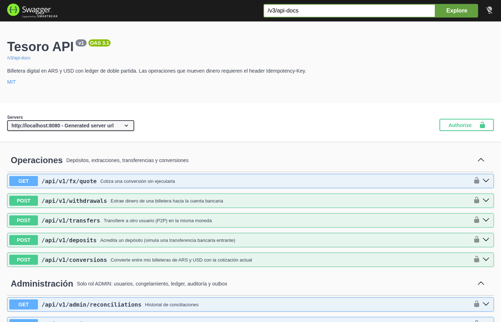
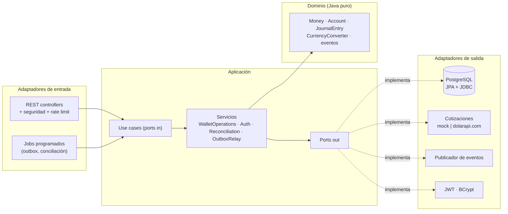
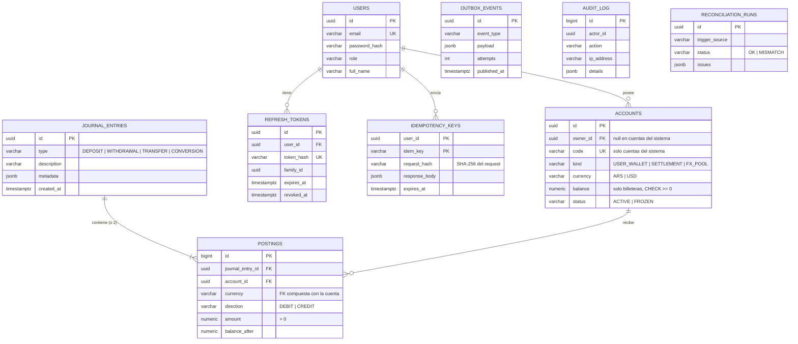
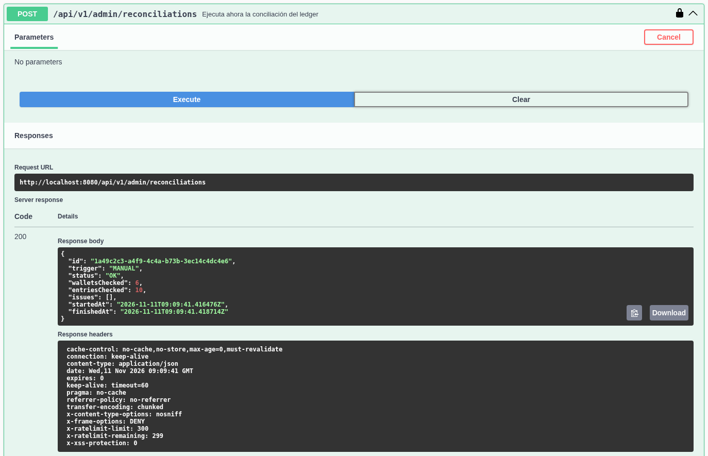
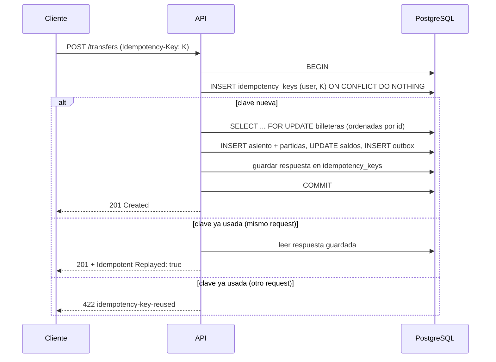
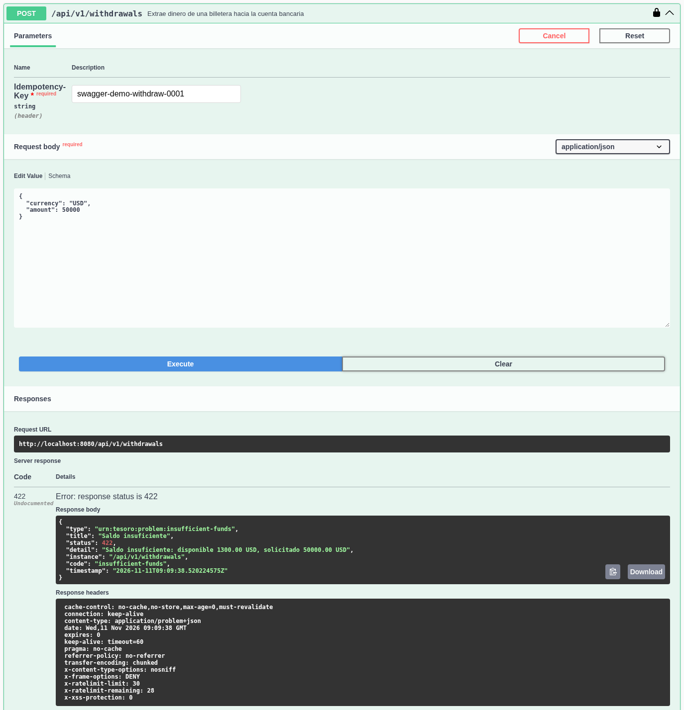
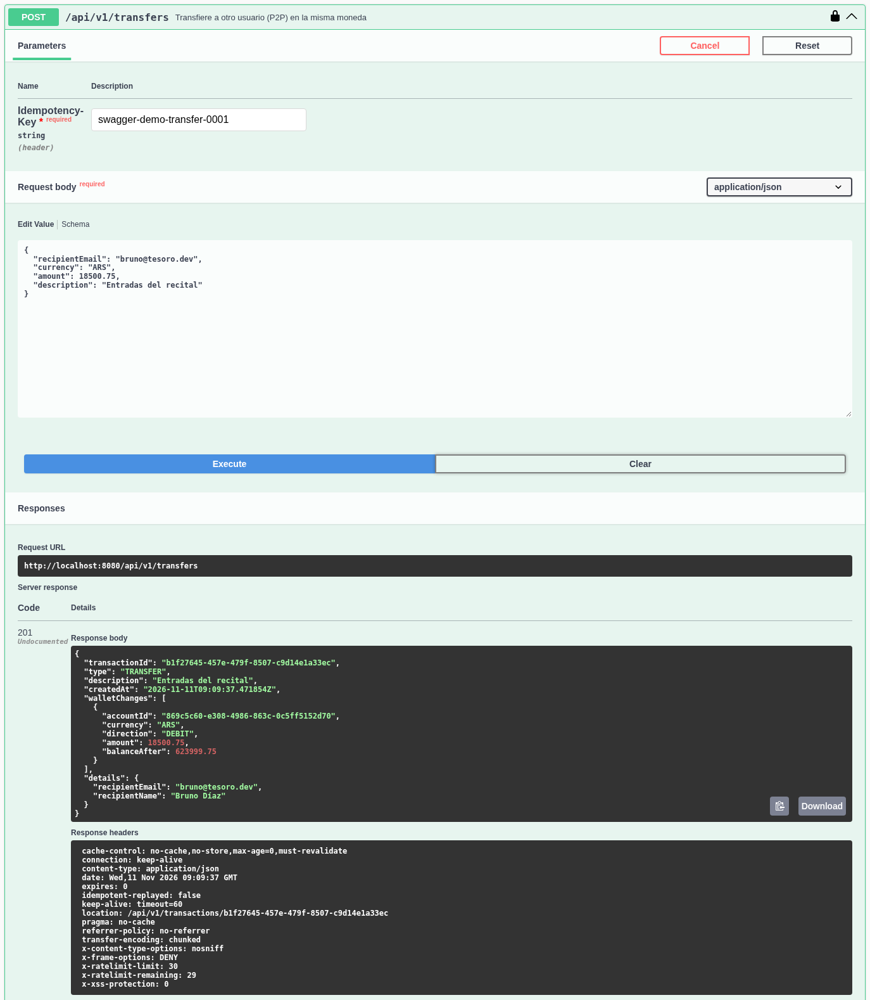
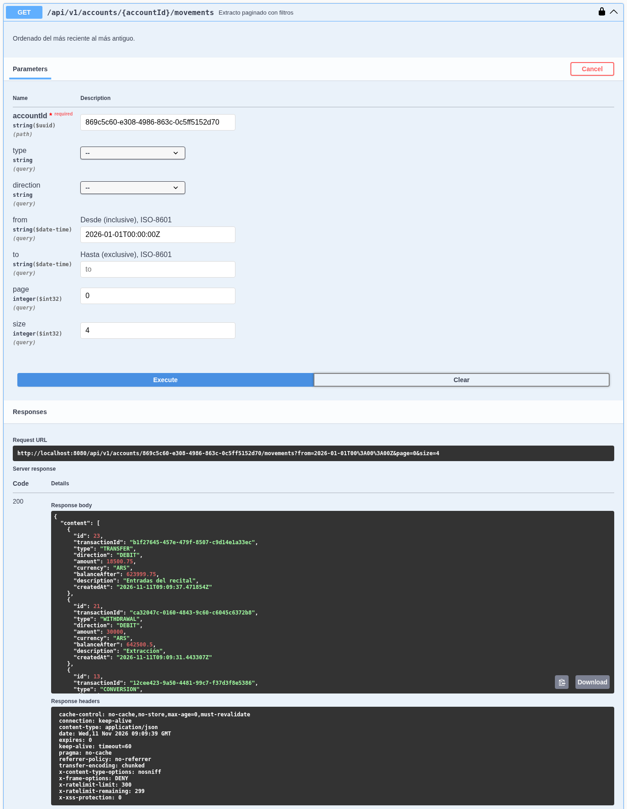
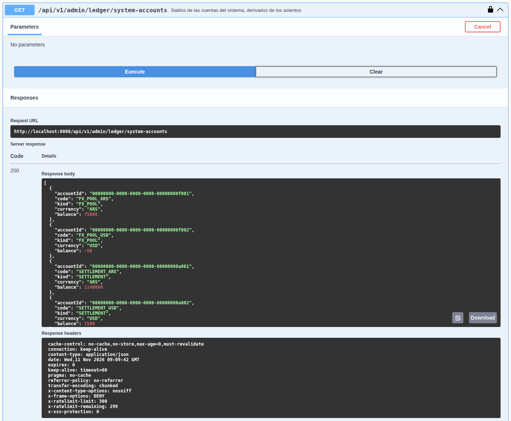

# Tesoro · Billetera digital con ledger de doble partida

[](https://github.com/acostamatias220/tesoro/actions/workflows/ci.yml)


Backend de una **billetera digital en pesos y dólares**: cada usuario tiene una billetera ARS y otra USD, puede depositar, extraer, transferir a otros usuarios y convertir entre monedas. Todo el dinero se registra en un **ledger contable de doble partida**, las operaciones son **idempotentes** y **seguras ante concurrencia** (no hay doble gasto) y un job de **conciliación** verifica periódicamente que los libros cierren.

> 🇬🇧 _Digital wallet / payments backend built with Java 21 and Spring Boot 3 using a hexagonal architecture. Every movement is a balanced double-entry journal entry in PostgreSQL (append-only, enforced by triggers); money-moving endpoints require an `Idempotency-Key`; wallets are locked pessimistically in a global order to avoid deadlocks; currency conversion goes through an FX provider port (mock or dolarapi.com with caching, retry and circuit breaker); domain events are published through a transactional outbox. JWT access + rotating refresh tokens, roles, rate limiting, RFC 9457 problem details, Prometheus metrics, scheduled reconciliation, unit + integration + concurrency tests against real PostgreSQL, Docker and CI._



---

##  Funcionalidades

- **Usuarios y billeteras**: registro, login y una billetera por moneda (`ARS` y `USD`) creada automáticamente.
- **Operaciones**: depósitos, extracciones, **transferencias P2P** (por email del destinatario) y **conversiones ARS ⇄ USD** con cotización de compra/venta.
- **Ledger de doble partida**: cada operación es un asiento balanceado; los asientos y sus partidas son **inmutables** (triggers que bloquean `UPDATE`/`DELETE`) y la base valida que cada asiento cierre **al hacer commit**.
- **Idempotencia**: los `POST` que mueven dinero exigen el header `Idempotency-Key`. Reintentar con la misma clave devuelve la respuesta original (`Idempotent-Replayed: true`); reutilizarla con otro cuerpo devuelve `422`.
- **Concurrencia**: bloqueo pesimista de billeteras en un **orden global** (sin deadlocks) + `CHECK (balance >= 0)` como red de seguridad. Tests con decenas de hilos simultáneos demuestran que no hay doble gasto.
- **Cotizaciones** mediante un *port* `ExchangeRateProvider` con dos adaptadores: **mock** (valores fijos) y **[dolarapi.com](https://dolarapi.com)** (dólar oficial) con **caché**, **timeouts**, **retry** y **circuit breaker** de Resilience4j.
- **Extracto paginado y filtrable** por tipo, dirección y rango de fechas, con saldo posterior a cada movimiento.
- **Conciliación programada** (y manual para administradores): asientos desbalanceados, balance de comprobación por moneda, saldos negativos y saldo cacheado vs. saldo derivado de las partidas.
- **Transactional outbox**: los eventos de dominio se guardan en la misma transacción que el movimiento y un job los publica (*at-least-once*, `FOR UPDATE SKIP LOCKED`, reintentos con registro del error).
- **Auditoría** de acciones sensibles (login, refresh, congelamiento de cuentas, reutilización de refresh tokens, etc.).
- **Administración** (rol `ADMIN`): usuarios, congelar/descongelar billeteras, saldos de las cuentas del sistema, conciliaciones, auditoría y estado del outbox.
- **Seguridad**: JWT de acceso (HS256) + **refresh tokens opacos con rotación** y revocación de toda la familia si se detecta reutilización, BCrypt, **rate limiting** con Bucket4j, errores en formato **Problem Details** (RFC 9457) y `404` en lugar de `403` para recursos ajenos.
- **Observabilidad**: Actuator (`health`, `liveness`, `readiness`), métricas **Prometheus** propias (`tesoro_movements_total`, `tesoro_outbox_pending`, `tesoro_reconciliation_issues`, …) y documentación **OpenAPI / Swagger UI**.

##  Stack

| Capa | Tecnologías |
| --- | --- |
| Lenguaje / framework | Java 21 (virtual threads), Spring Boot 3.5 (Web, Data JPA, Security, Validation, Actuator) |
| Persistencia | PostgreSQL, Flyway, Hibernate + `JdbcClient` para las consultas del ledger |
| Seguridad | Spring Security OAuth2 Resource Server (JWT HS256), BCrypt, Bucket4j + Caffeine |
| Integraciones | `java.net.http` + Resilience4j (circuit breaker y retry) |
| Mapeo / docs | MapStruct, springdoc-openapi |
| Observabilidad | Micrometer + Prometheus |
| Calidad | JUnit 5, AssertJ, Mockito, ArchUnit, JaCoCo, Spotless (palantir-java-format) |
| Infra | Maven Wrapper, Docker multi-stage (usuario no root), docker-compose, GitHub Actions |

##  Arquitectura

Arquitectura **hexagonal** (puertos y adaptadores). El dominio no depende de Spring ni de JPA, y la aplicación solo conoce interfaces (*ports*). Las reglas de dependencia se verifican con **ArchUnit** en cada build.



```
src/main/java/com/tesoro
├── domain/          # Money, Account, JournalEntry, Posting, CurrencyConverter, eventos y excepciones
├── application/     # ports in/out, servicios (casos de uso), comandos y modelos de lectura
├── adapter/
│   ├── in/web/      # controllers, DTOs, seguridad, rate limit, Problem Details
│   ├── in/scheduling/   # jobs de outbox y conciliación
│   └── out/         # persistence (JPA/JDBC), fx, messaging, security, request
└── config/          # propiedades, OpenAPI, reloj, bootstrap del admin y datos demo
```

##  Modelo de datos



##  Cómo funciona el ledger

Cada movimiento de dinero es un **asiento** (`journal_entries`) con dos o más **partidas** (`postings`). Cada partida es un débito o un crédito sobre una cuenta y, **por cada moneda, la suma de débitos es igual a la suma de créditos**. El dinero nunca aparece ni desaparece: solo se mueve entre cuentas.

| Cuenta | Qué representa | Naturaleza |
| --- | --- | --- |
| `USER_WALLET` | Lo que la plataforma le debe al usuario (pasivo) | Acreedora: un crédito aumenta el saldo |
| `SETTLEMENT_ARS` / `SETTLEMENT_USD` | Dinero real en el banco de la plataforma (activo) | Deudora: un débito aumenta el saldo |
| `FX_POOL_ARS` / `FX_POOL_USD` | Posición de cambio de la plataforma | Acreedora |

**Ejemplo.** Con cotización mock compra `1400` / venta `1450`:

1. Ana deposita **ARS 200.000**

   | Cuenta | Débito | Crédito |
   | --- | ---: | ---: |
   | SETTLEMENT_ARS | 200.000,00 | |
   | Billetera ARS de Ana | | 200.000,00 |

2. Ana transfiere **ARS 18.500,75** a Bruno

   | Cuenta | Débito | Crédito |
   | --- | ---: | ---: |
   | Billetera ARS de Ana | 18.500,75 | |
   | Billetera ARS de Bruno | | 18.500,75 |

3. Bruno convierte **USD 100** a pesos (se usa la cotización de **compra**, 1400). Una conversión tiene **dos patas**, una por moneda, y cada una cierra por separado a través de los pools de cambio:

   | Cuenta | Moneda | Débito | Crédito |
   | --- | --- | ---: | ---: |
   | Billetera USD de Bruno | USD | 100,00 | |
   | FX_POOL_USD | USD | | 100,00 |
   | FX_POOL_ARS | ARS | 140.000,00 | |
   | Billetera ARS de Bruno | ARS | | 140.000,00 |

4. Ana extrae **ARS 30.000** → débito a su billetera, crédito a `SETTLEMENT_ARS`.

Garantías a nivel base de datos (no solo en el código):

- `postings` y `journal_entries` son **append-only**: un trigger rechaza `UPDATE` y `DELETE`.
- Un **constraint trigger diferido** (`DEFERRABLE INITIALLY DEFERRED`) verifica al hacer **commit** que cada asiento esté balanceado por moneda.
- Una FK compuesta `(account_id, currency)` impide registrar una partida en una moneda distinta a la de la cuenta.
- Las billeteras guardan un **saldo cacheado** (`CHECK balance >= 0`) para leer y bloquear rápido; las cuentas del sistema **no**: su saldo se deriva de las partidas, así no se convierten en un punto de contención.

La **conciliación** (cada 10 minutos por defecto, en una transacción `REPEATABLE READ`) recalcula todo desde las partidas y reporta asientos desbalanceados, un balance de comprobación que no da cero, saldos negativos o diferencias entre el saldo cacheado y el derivado. El resultado queda guardado y se expone en la métrica `tesoro_reconciliation_issues`.



### Dinero y redondeo

- Todos los importes son `BigDecimal` con **escala 2**. Un importe con más decimales (`10.001`) se **rechaza** con `422`: nunca se redondea en silencio lo que mandó el cliente.
- En las conversiones el resultado se redondea **hacia abajo** (`RoundingMode.DOWN`): la plataforma nunca crea dinero de la nada por redondeo.
- USD → ARS usa la cotización de **compra**; ARS → USD, la de **venta**. La tasa efectiva informada usa escala 10 con `HALF_EVEN`.

##  Idempotencia y concurrencia



- La clave se registra **como primera sentencia de la misma transacción** que mueve el dinero. Si llegan dos requests iguales a la vez, el segundo **espera en el índice único** hasta que el primero termina y luego devuelve la respuesta guardada. Si la operación falla, el rollback libera la clave y el cliente puede reintentar.
- Cada request se identifica con una **huella SHA-256** del cuerpo normalizado: misma clave con otro contenido → `422`.
- Las billeteras involucradas se bloquean con `SELECT … FOR UPDATE` **siempre en el mismo orden** (por id). Dos transferencias cruzadas A→B y B→A no pueden quedar en deadlock.
- El saldo se valida con la fila bloqueada y, además, la base tiene `CHECK (balance >= 0)`.

Los tests de concurrencia (`ConcurrencyIT`, `IdempotencyIT`) lanzan decenas de operaciones en paralelo y verifican que el saldo final es exacto, que nunca queda negativo, que no hay deadlocks y que una misma clave produce **un solo** asiento.

## 🚀 Cómo correrlo

### Requisitos

- Java 21
- PostgreSQL 15+ (probado con 17 y 18)

### Local

```bash
# 1. Crear la base
createdb tesoro

# 2. Variables de entorno (ver .env.example)
export DB_URL=jdbc:postgresql://localhost:5432/tesoro
export DB_USER=postgres
export DB_PASSWORD=<tu-password>
export JWT_SECRET="$(openssl rand -base64 48)"
export ADMIN_EMAIL=admin@tesoro.dev
export ADMIN_PASSWORD=<una-password-de-12-o-mas-caracteres>
export SEED_DEMO_DATA=true          # opcional: crea ana@tesoro.dev y bruno@tesoro.dev

# 3. Levantar
./mvnw spring-boot:run
```

Flyway crea el esquema al arrancar. Luego:

- Swagger UI: <http://localhost:8080/swagger-ui.html>
- Health: <http://localhost:8080/actuator/health>
- Métricas: <http://localhost:8080/actuator/prometheus>

Si `SEED_PASSWORD` está vacío, la contraseña de los usuarios demo se genera al azar y se muestra en el log.

### Docker

```bash
cp .env.example .env      # completar DB_PASSWORD, JWT_SECRET, ADMIN_*
docker compose up --build
# con Prometheus en http://localhost:9090:
docker compose --profile observability up --build
```

La imagen es **multi-stage** (build con Maven, runtime `eclipse-temurin:21-jre-alpine` con capas de Spring Boot) y corre con un **usuario sin privilegios**.

### Colección de requests

En [`http/tesoro.http`](http/tesoro.http) hay un recorrido completo (login, depósito, transferencia, reintento idempotente, conversión, extracto y endpoints de admin) para el cliente HTTP de IntelliJ o la extensión REST Client de VS Code. Las credenciales van en `http/http-client.private.env.json` (ignorado por git, ver el `.example`).

##  Tests

```bash
# los tests de integración usan una base PostgreSQL real
createdb tesoro_test
export TEST_DB_URL=jdbc:postgresql://localhost:5432/tesoro_test
export TEST_DB_USER=postgres
export TEST_DB_PASSWORD=<tu-password>

./mvnw verify
```

`verify` ejecuta:

- **Unitarios** (`*Test`): dominio (`Money`, `Account`, `JournalEntry`, `CurrencyConverter`), servicios con mocks, adaptador de dolarapi contra un servidor HTTP falso (caché, fallback, circuit breaker) y reglas de arquitectura con **ArchUnit**.
- **Integración** (`*IT`) contra PostgreSQL real con la app levantada en un puerto aleatorio: auth y rotación de tokens, operaciones, idempotencia, **concurrencia**, integridad del ledger (triggers), administración, rate limiting y observabilidad.
- **JaCoCo** con umbral mínimo de cobertura de líneas y **Spotless** para el formato.

##  Variables de entorno

| Variable | Default | Descripción |
| --- | --- | --- |
| `DB_URL` | `jdbc:postgresql://localhost:5432/tesoro` | URL JDBC |
| `DB_USER` / `DB_PASSWORD` | `tesoro` / vacío | Credenciales de la base |
| `DB_POOL_SIZE` | `20` | Tamaño del pool de Hikari |
| `PORT` | `8080` | Puerto HTTP |
| `JWT_SECRET` | — (**obligatoria**) | Clave HMAC de los access tokens, mínimo 32 caracteres |
| `JWT_ISSUER` | `tesoro` | Emisor de los tokens |
| `ACCESS_TOKEN_TTL` / `REFRESH_TOKEN_TTL` | `15m` / `7d` | Vigencia de los tokens |
| `FX_PROVIDER` | `mock` | `mock` o `dolarapi` |
| `FX_MOCK_BID` / `FX_MOCK_ASK` | `1400.00` / `1450.00` | Cotización fija del proveedor mock |
| `RATE_LIMIT_ENABLED` | `true` | Rate limiting (auth 10/min por IP, operaciones 30/min por usuario, resto 300/min) |
| `RECONCILIATION_CRON` | `0 */10 * * * *` | Frecuencia de la conciliación |
| `ADMIN_EMAIL` / `ADMIN_PASSWORD` | vacío | Crea el primer administrador al arrancar |
| `SEED_DEMO_DATA` / `SEED_PASSWORD` | `false` / vacío | Datos de demo |
| `FORWARD_HEADERS_STRATEGY` | `none` | `framework` si corre detrás de un proxy |

##  API

Todas las rutas bajo `/api/v1`. Los `POST` de operaciones requieren `Authorization: Bearer …` e `Idempotency-Key`.

| Método | Ruta | Descripción |
| --- | --- | --- |
| `POST` | `/auth/register` · `/auth/login` | Registro y login (devuelven access + refresh token) |
| `POST` | `/auth/refresh` · `/auth/logout` | Rotación y revocación del refresh token |
| `GET` | `/me` | Usuario actual |
| `GET` | `/accounts` · `/accounts/{id}` | Billeteras propias |
| `GET` | `/accounts/{id}/movements` | Extracto paginado (`type`, `direction`, `from`, `to`, `page`, `size`) |
| `GET` | `/transactions/{id}` | Detalle de un asiento |
| `POST` | `/deposits` · `/withdrawals` | Depósito / extracción |
| `POST` | `/transfers` | Transferencia P2P |
| `POST` | `/conversions` | Conversión ARS ⇄ USD |
| `GET` | `/fx/quote` | Cotiza una conversión sin ejecutarla |
| `GET` | `/admin/users` · `/admin/users/{id}/accounts` | Usuarios y sus billeteras |
| `PATCH` | `/admin/accounts/{id}/status` | Congelar / descongelar una billetera |
| `GET` | `/admin/ledger/system-accounts` | Saldos de las cuentas del sistema |
| `POST` / `GET` | `/admin/reconciliations` | Ejecutar / listar conciliaciones |
| `GET` | `/admin/audit-log` · `/admin/outbox` | Auditoría y estado del outbox |

Los errores siguen **Problem Details** con un `code` estable:



##  Capturas

| Transferencia | Extracto |
| --- | --- |
|  |  |

| Cuentas del sistema | Conciliación |
| --- | --- |
|  |  |

##  Licencia

[MIT](LICENSE) © 2026 Matías Acosta
